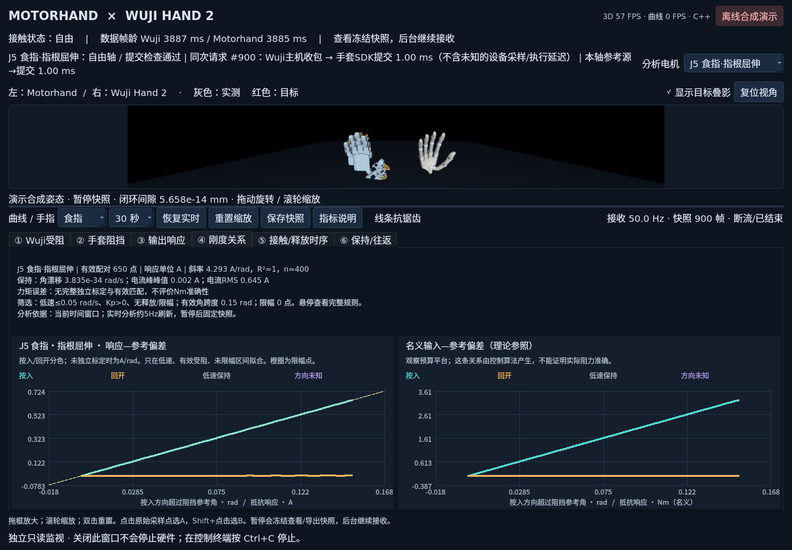

# 双手遥操作监视与六组反馈验证

`teleop-ui` 显示 Motorhand 与 Wuji Hand 2 的姿态，并用六组曲线核验受阻、代理位置、输出、时序和保持稳定性。界面和选区分析只读遥测，不参与闭链、重定向、局部代理逆解或PD控制。原来的 `sim`、`glove-wuji-viewer`、`force-ui` 入口保留原样。



## 启动

在工作区根目录运行。先用演示检查窗口，不连接设备：

```bash
pixi run teleop-ui --demo --port 8766
```

接真机时，终端一打开监视器：

```bash
pixi run teleop-ui --port 8766
```

本文沿用当前会话使用的8766端口；程序未指定时默认8765。终端二启动控制，**必须加与监视器一致的`--curves-port 8766`**才会发布数据。若原控制进程还在运行，先在其终端按Ctrl+C正常停止后再重启：

```bash
MOTORHAND_GLOVE_DRIVER=2 pixi run wuji-force-contact \
  --hand right \
  --wuji-serial WH2KA01260813020 \
  --approved-firmware 2.13.1 \
  --feedback-mode driver-impedance \
  --feedback-hardness 0.3 \
  --rate 50 \
  --curves-port 8766
```

控制命令会依次回零手套和Wuji，随后启动固定零位参考的跟随。窗口自身只接收本机UDP，不连接SDK、不清错、不使能，也不停止设备。**关闭窗口不会停止控制；停止请在控制终端按 Ctrl+C。** 本机同一端口只能有一个监视器；与旧`force-ui`同时使用时须分别配置独立的数据来源/端口，不能同时占用8766。上述命令是使用说明，不代表文档或监视器已代为启动硬件。

## 显示与交互

界面主文字20px，曲线刻度/通道值与说明16px。每张图下有简短说明，解释数据来源、单位和读法。

- 左侧为 Motorhand，右侧为 Wuji；Wuji 红色半透明模型为已提交目标，灰色为实测姿态。Motorhand 使用控制程序已经求解的完整68维模型树，不在绘图线程重新解闭链。
- 鼠标拖动旋转视角，滚轮缩放；可关闭目标叠影、复位视角、拖动上下区域之间的分隔条。
- 下方依次为“① Wuji受阻、② 手套阻挡、③ 输出响应、④ 刚度关系、⑤ 接触/释放时序、⑥ 保持/往返”。按手指筛选通道；“分析电机”选择该组内的原始J轴，供④、⑤命令/电流图及⑥使用。图例保留中文关节名及J1–J12编号。
- 新六页角度统一用rad、速度用rad/s。手套实际角、代理参考角、最终目标角统一为含现场zero的原始绝对电机坐标；它们不是闭链模型指节角。名义Nm和电流A分图，不强行放在同一量纲下比较。
- 各线使用自己的原始采样/计算源/串口提交时间。默认5秒窗，可选1/2/5/10/30/60秒。点击图例显隐；点击图内吸附原始采样点选择A，Shift+点击选择B，共享时间轴显示Δt，不插值造测量；时间差是选中事件的间隔，不自动等同于设备总延迟。
- 新六页严格使用每条线指定的原始时间：缺时刻就不画该点，不借整帧发布时间或位置时间补电流时间。旧指标定义及旧数据解析保持兼容；旧曲线的角度转°、时间回退等兼容行为不适用于新验证页。
- 点击`暂停数据`或在监视窗口按空格，冻结画面、曲线、游标和导出使用的同一份快照；后台数据独立接收，甚至新会话也不覆盖快照。再次按空格或点击`恢复实时`回到最新数据并清除缩放。长按空格不会反复切换。暂停监视不停止控制硬件，真机停止仍用控制终端的Ctrl+C。
- `保存快照` 导出当前查看的数据为JSONL，包含姿态和曲线字段，缺失数值保留null；同时写入同名`.selection.json`选区条件。缓冲上限3000帧，50Hz约60秒；更高频率下覆盖时长相应缩短。
- 控制结束或异常时尽力发送状态事件。窗口保留最后有效姿态和曲线，并显示原因；若事件丢包或进程突然退出，则由超过300ms的帧龄提示断流，不把最后画面当成实时状态。
- 窗口显示的Hz是遥测样本频率；UDP丢包或监视器负载可能使其低于控制频率。

## 六组曲线分别回答什么

| 页签 | 曲线与状态 | 读法与限制 |
| --- | --- | --- |
| ① Wuji受阻 | 同请求目标/实际角rad；受阻锁存与实际参与求解状态；同请求速度rad/s和电流A | 目标由`wuji_feedback_position_rad + wuji_feedback_error_rad`恢复，与请求输入配对。角差、停滞和电流一起观察；受阻后角差不天然意味着控制失败 |
| ② 手套阻挡 | 原始实际角、代理参考角、最终下发目标角；参考有效、力矩预算、软限位、代理位移/速率限制 | 预算或保护可能改变最终目标，不能把最终目标当代理参考。规划输入角和源时间另行保留，不能借当前实际角替代 |
| ③ 输出响应 | 提交名义总输入Nm、具独立标定依据的电流力矩估计Nm；单独的实测电流A | 默认仅看名义输入和电流各自响应，独立标定曲线为空。名义输入不是实测力矩；两侧电流比例不是验收标准 |
| ④ 刚度关系 | 所选J轴的响应—参考偏差散点；名义输入—参考偏差散点 | 横轴为沿阻挡方向超出参考的rad；默认响应A、斜率A/rad，完整独立标定时才用Nm、Nm/rad。名义关系只是算法参照，不是执行准确性证明 |
| ⑤ 接触/释放时序 | Wuji锁存/求解状态、四段软件耗时、所选J轴名义Nm和响应电流A | 判据完成、规划完成、SDK提交、电流收包各保留真实时刻；用A/B观察建立和撤除，不把软件收包→提交称为完整触觉延迟 |
| ⑥ 保持/往返 | 实际/参考/目标角rad、名义输入Nm、电流A、按入/回开回线 | 冻结选区检查漂移、峰峰值、RMS和往返形状。方向由滤波速度相对阻挡方向分类，不猜操作者意图 |

受阻锁存`contact_active_mask[20]`与实际参与求解`impedance_contact[20]`有意分开：后者只标记实际加入局部逆解normal/rhs的Wuji行，方向不符的上游候选行不算；整次规划失败时清空。释放迟滞中锁存可仍为1，而参与求解已为0。没有completed时参与mask为null，表示未知；完成的释放规划则是20项false。

`glove_proxy_valid[12]`只表示该轴存在有效受阻参考和±1方向。自由轴方向0且参考无效；无效参考角为null，UI也隐藏参考曲线，不沿用旧角。已有参考仍可能伴随撤力保护，因此参考有效不等于正在输出，也不能单独作为刚度拟合准入条件。⑤布尔状态使用原事件时刻的阶跃，不以两状态间斜线暗示提前变化。

## 坐标、快照与时间来源

每个completed输出使用`feedback_request_id`绑定其原始Wuji输入、手套规划输入、代理和最终提交。`wuji_feedback_*`与`glove_proxy_input_rad`不能被更晚的`wuji_current_a`或UI当前手套角覆盖。新①页恢复的是该请求目标，不是当前主周期的`wuji_target_rad`。

主链路栏显示所选电机“本轴参考源→提交 xx ms”；悬停可看`glove_proxy_source_ns[i]`和`glove_submit_ns`原始单调ns。缺少来源时提示未提供，不借发布时间。这个差值描述该轴输入到SDK提交的间隔，既不代替整个请求的最早输入年龄，也不等于物理接触或实际执行延迟。

对于映射系数`a=sign×scale`，原始绝对电机角为`zero_deg×π/180 + model_rad/a`；原始速度为`model_velocity/a`，按入方向乘`sign(a)`。当前实际角仅将`glove_raw_position_deg×π/180`。这些换算不改变现场zero，也不把电机角当作模型指节角。

| 数据 | 新验证页使用的时间 |
| --- | --- |
| 同请求Wuji目标、实际角、速度、电流 | `wuji_feedback_received_ns`，标识反馈输入快照；目标曲线横轴不是目标实际提交时刻 |
| 受阻锁存 | `contact_evaluated_ns`，`ForceController::step`返回后的主机时刻 |
| 实际参与求解mask、代理参考与有效性、代理限制 | `impedance_planned_ns`，规划器返回后的主机时刻 |
| 手套当前原始实际角 | 逐轴`glove_motor_received_ns[i]` |
| 代理规划当时输入角 | 逐轴`glove_proxy_source_ns[i]`，保留在请求内，区别于参考曲线的规划完成时间 |
| 手套规划滤波速度 | 逐轴`glove_driver_velocity_received_ns[i]`，未更新速度时为空 |
| 最终目标、提交名义总输入、合并输出保护 | `glove_submit_ns`，12轴中最后一次主机SDK/串口提交完成 |
| 实测电流与独立标定力矩估计 | 逐轴`glove_current_received_ns[i]`；不使用位置时间替代 |

四段`validation_timing_ms`依次为收包→判据、判据→规划、规划→提交、收包→提交，均由同一请求的上述时刻相减并除10⁶；缺时刻或倒序则对应项为空。判据时刻不是物理接触时刻，SDK提交不是设备开始执行。触发去抖可能跨多个请求，未知设备采样、SDK内部发送排队及机械响应不由这四段耗时给出。

## 选区分析、配对与筛选

时间曲线的A/B、拖框和暂停沿用原始样本；散点拖框/滚轮仅缩放散点坐标，不会凭空生成样本。分析使用当前查看的同一份快照及选定时间区间，后台接收的新帧不会覆盖暂停数据。选区按响应电流的原收包时刻取闭区间，建立索引时仍保留选区之前的有效已提交命令。

- 以手套独立电流收包时刻为响应时钟；实际角只取同会话连续序号段中不晚于电流的最近真实位置，默认允许时差≤20ms，不插值、不使用未来角度。
- 命令取同段最近已提交请求。原`glove_output_source_ns`为该请求Wuji输入与最旧手套输入的较早者；从原输入时刻起达到100ms即失效，不能用较晚提交时间续期。20ms并不是命令提交年龄的上限。
- 滤波速度源必须不晚于命令提交，且距电流响应≤20ms。沿阻挡方向速度>0.02rad/s为按入，<-0.02rad/s为回开，其间为低速保持；未知或超期速度标为unknown，不猜为保持。
- 刚度拟合要求参考有效、方向±1、已提交kp>0、沿参考超出量≥0、按入或保持且速度绝对值≤0.05rad/s。三类限幅必须明确为false，并排除释放/撤离原因；回开、限幅、未知保护等散点可用于观察，但不参与拟合。
- 带截距线性拟合默认至少8个合格点，且有效角跨度≥0.005rad；否则显示不可用。响应保留方向：`x=direction×(actual−proxy)`，默认`y=−direction×current`，独立标定完整时改用标定力矩；负响应不会取绝对值隐藏。
- 保持统计只取满足上述准入条件的hold样本。电流给出峰峰值、RMS和标准差；角漂移按去重后的真实位置源点对时间回归，不跨会话或序号断档。
- 序号断档重新建立来源索引；重复真实源时刻去重，矛盾内容不任取其一。分析结果保留有效配对、拟合点数、丢弃/限制计数，以及位置配对时差、命令年龄、输入年龄和速度年龄。界面使用简短摘要显示结论与分析依据；悬停摘要可查看完整筛选和配对规则，实时分析约5Hz更新，暂停后固定快照。

独立标定完整时，Nm误差按有效因果配对的`标定力矩−提交名义输入`计算均值、RMSE和峰值绝对误差；它与低速保持/刚度拟合使用不同的筛选集合，不可把二者点数等同。没有完整独立标定则显示不可用，不用同一PD公式重算结果当执行准确性证据。

## 保存与复算选区

保存`monitor-xxx.jsonl`时，会另存`monitor-xxx.selection.json`。JSONL仍是原来的逐帧数据格式，包含当前查看快照的完整缓冲而不是仅裁出A/B区间；选区文件记录如何从这份数据复算。两份文件应一起保留。

| 选区文件字段 | 含义 |
| --- | --- |
| `schema_version` / `type` | 固定为`1` / `teleop_validation_selection` |
| `data_file` / `session_id` | 对应JSONL文件名与当前显示会话ID |
| `raw_axis_index` / `axis_label` | 所选原始轴的零基索引与显示名称，例如索引4对应J5 |
| `time_range_ns` | 用于分析的绝对单调ns起止；优先有效A/B区间，否则当前时间窗口 |
| `cursor_a_ns` / `cursor_b_ns` | 保存时A/B原始游标时刻，未选时为null |
| `paused` / `frame_count` | 保存时暂停状态与JSONL对应帧数 |
| `options` | 实际`ValidationOptions`参数：配对20,000,000ns、低速0.05rad/s、保持死区0.02rad/s、最少8点、最小跨度0.005rad等 |
| `note` | 复算说明 |

选区文件不保存可能落后于实时帧的后台分析结果；复核时读取同名JSONL，用`raw_axis_index`、`time_range_ns`与`options`重新运行只读分析。独立标定信息仍随JSONL帧内`torque_conversion`保留，不能在复算时偷偷换用新系数。任一文件写入失败，界面提示保存未完整完成，应检查两份文件是否齐全。

## 力矩标定与关节名称

默认配置`config/feedback/wuji-monitor-torque.json`中的5.1 Nm/A仍只供旧诊断字段`glove_estimated_torque_nm`使用，不能进入新六页的验证力矩、Nm/rad拟合或Nm误差。Wuji暂无有效Kt，各轴为null；旧反射诊断字段仍兼容，但新六页不依赖它。缺失不填零，不以限流或名义力矩上限反推系数。

新验证字段`glove_validated_torque_nm`要求配置显式提供`glove_calibrated=true`、非空`glove_calibration_id`以及对应轴非零有限`glove_nm_per_a`，并保留系数来源说明；可选的`glove_bias_a`必须是12轴有限A值，未提供则按0处理。换算为`(I−bias)×Kt`。程序检查声明和字段完整性，标定依据本身仍应来自独立记录；单纯填入空载参考不构成独立证据。

散点与统计对所选轴整份分析快照固定证据等级：只要任一真实电流样本没有完整独立标定，就统一使用A和A/rad，并关闭Nm误差；不在同一结果中混用参考换算与独立标定。即使声明有效，电流换算仍是估计，不等于力矩传感器实测或净接触力。

普通四指的S1/S2/S3/S4依次为指根屈伸、指根侧摆、中节屈伸、末节屈伸；拇指依次为掌根屈伸、掌根外展、指根屈伸、指尖屈伸。UI直接显示中文名称。手套中末节驱动的电机角不等于模型中节指节角。

新 `force-contact` 默认驱动器阻抗方式并启用有效自由空间的摩擦补偿。UI按模式区分规划值、发送时总名义估算、PD部分和摩擦前馈；`--feedback-mode torque` 可回退旧方式。参数和控制边界见 `../../config/feedback/driver-impedance-native.md`。

## 实际分支原因

`glove_control_reason[12]`由原生真实分支记录，规划与提交原因可用`|`合并。共有25种已定义原因，另有`unknown`表示未提供，界面给出中文释义并保留原始字段。原因不会参与或改变控制。

| 原因 | 含义 |
| --- | --- |
| `inactive_geometry`、`invalid_input`、`invalid_geometry` | 上游active未激活；位置/源时刻无效；矩阵非有限。未激活不会继续猜测上游更细原因 |
| `unobservable_geometry`、`singular_transmission`、`invalid_contact_row`、`inverse_failed` | 最终Jacobian总范数不足；传动不可逆/条件不足；候选受阻行无效使整次释放；逆解非有限 |
| `contact_pd`、`free_axis`、`coupled_release`、`friction_disabled` | 规划形成PD；自由轴；无逆解方向但仍耦合锁存接触而抑制摩擦；自由摩擦配置关闭 |
| `outside_proxy`、`zero_stiffness`、`planner_release_guard` | 未超过代理；有效刚度为零；作用距离或当前/预测输出触发原有撤力保护 |
| `proxy_offset_limited`、`proxy_rate_limited` | 代理偏移、参考移动速率实际受限，对应proxy_limited |
| `soft_limit_target`、`soft_limit_release` | 目标限位或软限位处朝外输出撤力，对应motion_limited |
| `torque_budget_limited`、`friction_limited`、`sdk_gain_limited` | 名义总预算、自由摩擦幅值、MIT增益范围实际受限，对应torque_limited |
| `sdk_zero_output`、`sdk_direction_release`、`sdk_budget_release`、`sdk_output_accepted` | 精确零电流分支；量化后方向保护撤力；预算缩放尝试耗尽撤力；量化MIT命令接纳 |

`coupled_release`也可能是局部逆互相抵消，`planner_release_guard`不证明人手主动回开。`contact_pd`和后续SDK撤力原因可以同时出现。拟合除检查三类限幅和正kp外，还排除包含`release`、`retract`或`withdrawal`的原因；不从图形平台或当前角差反推保护原因。

无completed时参考角、规划输入/源时间和速度为空，方向0、参考有效及限制标志false，原因unknown；不能把这组缺失状态解释为“有效控制且没有限幅”。失败但没有completed时沿用终止事件，不制造轴级原因。逐字段定义见[原生验证遥测契约](feedback-validation-telemetry.md)。

## 使用边界

当前只支持右手。旧控制二进制没有完整树字段时，手套模型只能显示预览/最后姿态，并明确标记缺失；通过 `pixi run wuji-force-contact` 会自动构建新版。

仿真预览/离线演示用合成数据，明确标记，不证明真机触觉。名义Nm是指令，不是实测接触力；电流是电流，不转换为未经标定的接触力。

控制端的 `ve33: target outside continuous assembly branch or closure did not converge` 仍触发原停机保护。此版用于观察故障前状态与停机原因，没有放宽模型装配分支，也未修复该求解问题。窗口只保留最后成功发布的帧，不把失败姿态当成有效姿态。SDK编码器/堵转告警详情仍在控制终端。

## 离线验证范围

本轮相关Python回归106项通过，覆盖合成自由→受阻→慢压→保持→释放、反向轴、独立标定门控、同请求快照、缺失/乱序/超期、暂停导出及长时间窗。`test_feedback_validation_analysis.py`检查分析，`test_validation_views.py`检查新六页，既有监视器测试保留兼容与交互覆盖；后续改动仍应以当次测试报告为准。

本次原生12项离线测试通过；修改前后1000帧规划控制输出逐字节相同，5类×12轴PTY实际编码报文及名义提交结果也相同。完整240项矩阵、长数值与全部原因的压力遥测包为24,365字节，低于32KiB，没有裁剪数组或降精度。这些离线结果不证明真机触觉，本轮文档与监视开发没有自动启动硬件。

## 帧率、框选和指标说明

默认目标60FPS，右上角显示实际3D绘制FPS、曲线绘制FPS和使用的后端；数据接收Hz另列，不能混淆。C++逐点构造曲线路径，保留所有样本和原始时间戳；缺失值、序号跳变、时间倒退及断流不会跨接。没有启用数据抽稀、滤波或补值。缓存仅避免重复整理数据；源JSONL数值不改。

2026-11-13在本机RTX3090Ti、1700×1180、新默认①页、50Hz合成输入下复测：5秒窗3D 58.9FPS，60秒窗3D 58.8FPS；60秒窗每次曲线绘制均值1.50ms、P95 1.84ms，保留全部3000帧。这是指定布局的离线结果，不作为所有页面和设备的帧率保证。以当前窗口实际FPS为准。默认轻量曲线绘制关闭线条抗锯齿，文字与3D不受影响；勾选“线条抗锯齿”可提高线条平滑度但会增加开销。Qt版本不匹配或C++库不可用时保留全点Python后备。

- 时间曲线左键拖框：自动冻结快照，时间曲线共享放大的时间范围，选中图单独放大纵轴。散点拖框仅缩放该图x/y坐标，不改变分析时间窗口；时间选区由时间图或A/B确定。
- 滚轮：以鼠标附近缩放；双击图内或“重置缩放”恢复全图。
- 放大到足够细时显示原始采样点，A/B只吸附真实存在的点；没有点的区间不伪造读数。
- “指标说明”或双击图标题：查看来源、公式、单位、方向、时间戳和限制。列表优先列新六组所用字段，名称按当前控制模式解释，旧指标仍可查。SDK提交不等于设备执行，电流×Kt也不是独立力矩传感器实测。

`pixi run teleop-ui --fps 60` 可指定目标；`--curve-backend python` 可验证后备路径，`--smooth-curves` 可启用平滑线条。启动任务会自动构建独立的Qt C++显示库，不改控制程序的频率。

## 旧数据和指标说明兼容

“指标说明”继续保留旧投影、保护后请求、前馈、参考Kt换算和模型指节角定义，便于读旧导出；新页面不因此把这些旧诊断量当作当前独立力矩证据。驱动阻抗模式中`glove_target`为编码参数在提交准备时状态下的总名义PD估算；纯力矩模式中则为量化前馈。旧虚拟力矩或诊断投影不叠加为新阻抗输入。

新六页没有完整字段或原始时间时保持空白并提示更新控制端。旧数据能解析不代表足以完成新验证；缺失不能用当前帧、未来样本或整帧时间补成看似完整的响应链。
